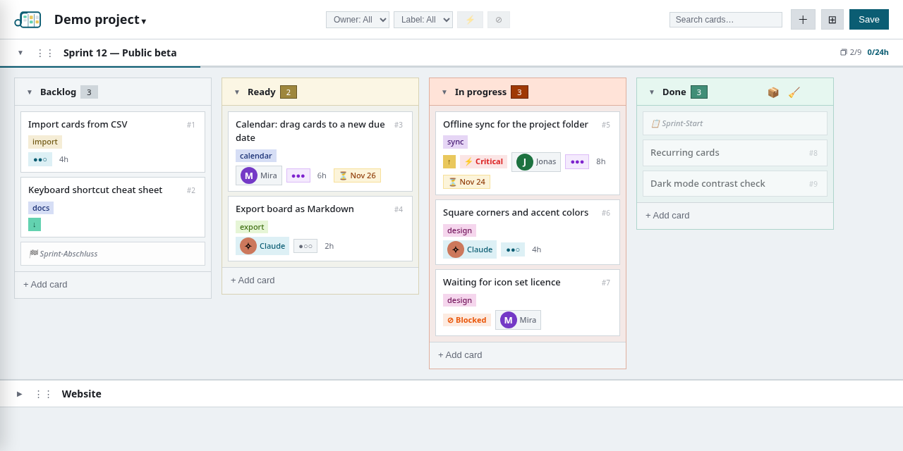

<div align="center">
  
  <h1>aBoard</h1>
  <p><strong>Offline-Kanban als einzelne HTML-Datei</strong></p>
</div>

---

[English](README.md) · **Deutsch**

aBoard ist ein Kanban-Board, das als einzelne HTML-Datei direkt im Browser läuft: keine Installation, kein Internet, kein Backend. Doppelklick, und los.

<picture>
  <source media="(prefers-color-scheme: dark)" srcset="docs/images/board-dark.png" />
  
</picture>

Die Idee stammt von [Nullboard](https://github.com/apankrat/nullboard) von Alex Pankratov, aBoard geht aber weiter: Sprints als Swimlanes (waagerechte Zeilen quer durch alle Spalten), strukturierte Karten mit Markdown, Flags, Schätzungen und Verweisen, ein Kalender, Vorlagen und wiederkehrende Karten.

## Was in diesem Repository liegt

Dieses Repository ist ein **öffentlicher Abzug** des Projekts. Es enthält die Board-App (Quellcode, Build, Tests) und das Nutzerhandbuch. Der optionale Mehrbenutzer-Server folgt später. Die Entwicklung selbst läuft in einem internen Repository; Kommentare im Code verweisen deshalb gelegentlich auf Entscheidungen (`ADR-…`), Befunde (`F-…`) oder Karten (`#…`), die hier nicht beiliegen.

## Schnellstart

**Fertige Datei:** `aboard.template.html` hängt an jedem Release (Seite „Releases“ dieses Repositorys). Herunterladen, im Browser öffnen, fertig. Die Datei lässt sich kopieren, verschicken und überall öffnen; die Daten stecken in ihr selbst, ein Export als JSON ist eingebaut.

**Selbst bauen** (mit [Bun](https://bun.sh) in einer aktuellen Version):

```bash
bun install
bun run build:template      # erzeugt aboard.template.html
```

`bun run build` erzeugt zusätzlich `aboard.html` mit der Op-Inbox-Schicht für das gemeinsame Schreiben mit Werkzeugen außerhalb des Browsers. Welche Fassung wofür taugt, steht unter [Varianten](docs/handbuch/varianten.md).

## Dokumentation

Das **[Handbuch](docs/handbuch/README.md)**: [Varianten](docs/handbuch/varianten.md) · [Installation](docs/handbuch/installation.md) · [Bedienung](docs/handbuch/bedienung.md) · [Entwicklung](docs/handbuch/entwicklung.md).

## Funktionen

| Bereich | Was |
|---|---|
| **Board** | Spalten Backlog → Ready → In Arbeit → Erledigt, Drag & Drop, mehrere Boards |
| **Swimlanes** | Sprints und thematische Zeilen, ein- und ausklappbar, archivierbar |
| **Karten** | Markdown-Beschreibung, Owner und Beteiligte, Labels, Kommentare, Anhänge, Fälligkeit mit Uhrzeit |
| **Flags und Schätzung** | ⚡ Kritisch · ⊘ Blockiert · ✓ QA; Komplexität und Aufwand in Stunden |
| **Verweise** | blockiert / hängt ab von / verwandt, mit Rückverweis auf der Zielkarte |
| **Vorlagen** | Karten-Vorlagen und wiederkehrende Karten |
| **Kalender** | Monats- und Wochenansicht, Termine auch ohne Karte |
| **Suche und Filter** | Volltext (`/`), Filter nach Owner, Label und Flags |
| **Tastatur** | `n` neue Karte · `j`/`k` navigieren · `?` Hilfe |
| **Oberfläche** | Hell/Dunkel, Deutsch/Englisch, mobil bedienbar |

## Entwicklung

```bash
bun install
bun run dev                              # Entwicklungsserver
bun run build && bun run build:template  # beide Fassungen
bun run test                             # Tests in beiden Build-Kontexten (nicht: bun test)
```

`bun test` (Buns eigener Test-Runner) funktioniert nicht, weil er die Browser-Umgebung (happy-dom) nicht einrichtet; immer `bun run test`.

Die Dokumentation gibt es auf Deutsch und Englisch.

## Lizenz

Apache License 2.0, siehe [LICENSE](LICENSE).
