# Usage

**English** · [Deutsch](../handbuch/bedienung.md)

This chapter explains everyday work with the board: columns, cards, swimlanes, filters, calendar, keyboard and signing in to the server. Some functions exist only with the multi-user server; this is noted where it applies.

Which variant you have in front of you is explained in [Variants](variants.md).

## In five minutes: the essentials

- aBoard shows a **Kanban board**: columns with cards that represent tasks. The columns reflect the status, from left to right.
- As a **single file**, aBoard is one HTML file: double-click, open in the browser, done. **Save** writes the board into this file.
- With a **folder connection**, the board lives in a folder as `aboard-sync.json`. You never touch the file by hand and keep **only one browser tab** with the board open.
- On a **server board** you work in the browser at the server's address; changes by others appear by themselves. How to sign in and get an account is described in [Signing in and your account](#signing-in-and-your-account).
- What you control yourself: putting cards in the right column, setting flags, entering due dates.

## The screen

**Header:** logo, board title, search field, filters, the buttons **＋** (add column), **⊞** (add swimlane) and **Save**. On narrow screens some of them move into the **⋯** menu.

**Menu:** A click on the **logo** opens the sidebar. It contains:

| Area | Contents |
|---|---|
| File | Open, Export (JSON) |
| Views | Calendar |
| Settings | **User Settings** (identities, theme light/dark/system, card density, appearance — rounded or square corners, font system/serif/monospace, accent color —, language German/English; applies to this device) and **Board Settings** (mode and project folder, board background, templates, attachment limits) |
| Documentation | only in `aboard.html` connected to a folder: read the project's README and knowledge index |
| more | server only: Knowledge (if set up), Server administration (for admins), Clients and Projects |

At the bottom of the sidebar is the version of aBoard.

**Appearance:** boxes are **square** by default. In User Settings you choose corners (rounded or square), font (system, serif, monospace) and accent color (teal, blue, green, violet, graphite). The choice shows immediately as a preview; "Cancel" undoes it. It applies to this device and browser, not to everyone on the board.

## Columns

A fresh board has four columns: **Backlog → Ready → In Arbeit → Erledigt**. The default titles are German in every interface language (*In Arbeit* = in progress, *Erledigt* = done); click a title to rename it.

| Column | Meaning |
|---|---|
| Backlog | parking lot for ideas: captured, but not yet released for work |
| Ready | commitment point: this is to be done next |
| In Arbeit | currently being worked on (in progress) |
| Erledigt | completed (done) |

Columns can be renamed (click the title), collapsed, added (**＋**) and deleted. The column header also offers bulk actions: archive or delete all cards of the column. Deleting applies across all swimlanes, which is why aBoard asks first.

The column names are a default, not a fixed rule of the software.

## Swimlanes: sprints and lanes

Swimlanes are horizontal rows across the whole board. Every card belongs to exactly one swimlane. At the very top there is always the **Backlog** swimlane for everything that is not assigned to a sprint.

With **⊞** you create a new swimlane and choose its type:

- **Sprint** — a work period with a start and an end. Every sprint gets two special cards: **📋 Sprint-Start** for instructions and notes at the beginning, **🏁 Sprint-Abschluss** for the retrospective at the end. As soon as the first card of the sprint leaves the Backlog, the start card moves to Erledigt when the board is loaded; this shows that the sprint is running. The sprint header shows progress, for example "3/8 cards", and, once effort has been estimated, done against estimated hours.
- **Lane** — a topic or person row without sprint mechanics: no special cards, no progress display.

A swimlane can later be switched between sprint and lane, collapsed and expanded, and moved (drag the handle or use the arrow keys up/down). When a sprint is deleted, its cards move to the Backlog.

The special cards 📋 and 🏁 can be neither deleted, moved nor archived; only description and comments can be edited.

**Archiving swimlanes:** With **📦** in the sprint header, a whole swimlane disappears from the board. Its cards are preserved unchanged. With the "Show archive" filter it reappears, collapsed and with the note "Archived".

## Cards

### Creating and moving

- **"+ Add card"** at the bottom of a column, or the `n` key. If templates exist, you first choose "Empty" or a template.
- **Moving** by drag & drop, also between swimlanes. This works on smartphones too.
- **Several cards at once:** with Ctrl-click (Mac: Cmd-click) select cards one by one, with Shift-click a range, with `Ctrl+A` all visible ones. A bar then offers Move, Set owner, Add/Remove label and Delete. `Esc` clears the selection.

Every card has a running number (`#12`) by which it can be referred to unambiguously.

### The card window

A click on a card opens it. The window has several tabs:

| Tab | Contents |
|---|---|
| Details | title, description (Markdown), labels |
| Comments | comment history; `Ctrl+Enter` sends a comment |
| ⛓ Links | links to other cards |
| 📎 Attachments | files and images |
| 📋 History | who changed what and when |
| 🤖 Agent context | project mode and server only, when Claude is owner or involved: a context package for AI agents |

Below are the fields of the card (see the next section). When the window is closed, aBoard saves the changes automatically.

**Description:** It opens in reading mode. The **✏** button (tooltip “Edit”) switches to editing mode: a click on a paragraph makes it editable, and a toolbar helps with formatting (`Ctrl+B` bold, `Ctrl+I` italic, headings, lists, checklists, links, quotes). **"✓ Done"** switches back. Checkmarks in checklists can also be set in reading mode. aBoard loads images from foreign servers only after a click, so that nothing goes onto the network unnoticed.

**Exporting a card:** The "📄 Export" menu in the card window prints the card or saves it as a PDF, saves it as Markdown, or opens an email with its content.

### Card fields

| Field | Meaning |
|---|---|
| **Priority** | Low, Medium, High |
| **Labels** | free keywords, separated by commas, for example `bug, feature` |
| **Owner** | who is responsible for the card: a person or, in project mode and on the server, a Claude model |
| **Assignees** | further people or models who contribute |
| **Complexity** (Simple/Medium/High) | a rough estimate of how demanding the task is — project mode and server only |
| **Effort (h)** | estimated hours, for example `0.5` — project mode and server only |
| **⚡ Critical** | the card is urgent and blocks progress |
| **⊘ Blocked** | the card is waiting for something else (an answer, an external system) |
| **✓ QA** (“QA done”) | the card has been checked and is ready for acceptance |
| **Due date** | a deadline; optionally with a time |
| **Start date** | a start date; optionally with a time, for information only |
| **Recurring** | daily, weekly (with weekday) or monthly (with day of the month) |

Complexity and effort help to estimate a task realistically before it starts; the tile shows both as small badges. The flags Critical, Blocked and QA are simple yes/no switches, visible as symbols on the card.

**Due date:** An overdue card gets a red badge, one due within the next three days a yellow one. In the Erledigt (done) column the badge is omitted.

**Owner and identities:** Which names are available in the Owner field is set under User Settings → Identities (display name, color). On a server board, the Owner field instead offers the people who have a role on the board; Claude models only on boards that already use them.

### Recurring cards

A card with a repeat is a template that stays in the board. When the next date falls due, aBoard creates a new card as a copy when the board is loaded. The copies themselves carry no repeat.

### Templates

In the card window, **"Save as template"** saves a card as a template. When you create a new card, the template is then offered for selection. Templates are managed in the Board Settings.

### Links between cards

In the **⛓ Links** tab you connect cards with each other:

| Type | Counterpart on the other card | Meaning |
|---|---|---|
| blocks | blocked by | this card holds up the other one |
| blocked by | blocks | this card is waiting for the other one |
| depends on | required for | soft dependency, can be worked on in parallel |
| required for | depends on | the other card needs this one |
| related to | related to | for information only |

aBoard enters the counterpart on the other card automatically. A card with an open "blocked by" shows the ⛔ badge. If you move it anyway, aBoard asks. When the blocking card is done, aBoard reports that the other one is now free.

### Attachments

In the **📎 Attachments** tab you add files: via "Choose file…" or by drag & drop onto the window. An image can serve as the card's **cover** and then appears on the tile.

Where the files end up depends on the variant:

- **Single file:** in the HTML file itself. That is why there are limits for the individual file and for the total size of the board (adjustable in the Board Settings). Large attachments make the file sluggish.
- **Project mode:** in the `attachments/` subfolder of the project folder.
- **Server:** on the server. There, files can also be attached to comments. Deleting works only while the server is reachable and you are logged in: if it fails, the attachment stays in the card and a note explains why (no permission, or try again later). If you delete a whole card while the server is not responding or your login has expired, aBoard tries to remove its files again as soon as your deletion has reached the server — as long as the tab stays open. If you close it beforehand, the files remain on the server.

### Archiving

Done cards that you no longer want to see but want to keep are archived (**📦 Archive** in the card window, or for a whole column in the column header). Archived cards disappear from the column but are kept and included in the export. The column header shows with 📦 and a number how many are there. The special cards 📋 and 🏁 cannot be archived.

## Searching and filtering

**Search:** the `/` key or a click into the search field. The search ignores upper and lower case and covers title, description, comments, labels and owner. Cards without a match are hidden, matches are highlighted. A cross in the field resets the search.

**Filter:** in the header you filter by owner (also matches assignees), by label, and by the flags ⚡ Critical and ⊘ Blocked. Unlike the search, the filter does not hide but **dims** the cards that do not match; this keeps the context visible. The "Show archive" switch shows archived cards and swimlanes.

Search and filter are not saved; after a reload everything is visible again.

## Calendar

**Menu → Views → Calendar** shows all cards with a due or start date. There are three views: **Month**, **Week** and **Agenda** (the next 30 days). Cards with a time appear at that time.

- **Dragging** a card to another day moves its dates.
- A click into an empty day creates a **new card** with that date.
- Filters: show done cards, restrict by owner.

Additionally, on the server only:

- **All boards** — the calendar shows cards from all boards you may read,
- **Events without a card** — "＋ Event" creates a pure event (title, date, optionally multi-day, from/to, location, description),
- **Subscribe** — a secret calendar address for calendar apps,
- filter by project.

## Board overview and multiple boards

A click on the board title in the header opens a menu with the current and the most recently used boards; "Show all boards…" shows the full list. The pencil ✎ next to the title renames the board. On the server there is also "New board" there.

**Tabs:** If you use several boards, a tab bar below the header shows the most recently used ones, at most six. A click on a tab switches the board; the current one is highlighted. New boards are added at the end; beyond six, the one unused for the longest time drops out. The × on a tab removes it from the bar, the board itself stays. Each browser remembers its own bar. With only one board the bar does not appear. It exists on the server and in Claude Code mode, not in the single-file board (template `aboard.template.html`). On the server a tab shows **💬** when Claude is waiting for your reply on that board; the question itself appears in the banner once you open the board. The tab is refreshed at most once a minute.

On a **server board**, "Show all boards…" opens the **board overview**: all boards you may see, as tiles with a background image, separated into "My boards" and "Shared with me". Each tile shows role, modification date and the board ID, which can be copied with a button. A board can be shared in the Board Settings in the "Sharing" section.

## Keyboard

| Key | Effect |
|---|---|
| `/` | focus the search field |
| `n` | new card in the first visible column |
| `j` / `k` | highlight next / previous card |
| `Enter` | open the highlighted card |
| `Esc` | clear multi-selection, otherwise clear the highlight or close the help |
| `?` | open/close the overview of shortcuts |
| `Ctrl+A` / `Cmd+A` | select all visible cards |

The shortcuts do not work while an input field has focus or a card window is open. The card window has its own shortcuts: `Esc` closes, `Ctrl+B`/`Ctrl+I` format, `Ctrl+Enter` sends a comment.

## Saving, opening, exporting

| | Single file | Project mode | Server |
|---|---|---|---|
| **automatic** | interim state in browser storage | every change lands in the project folder | every change lands on the server |
| **Save** | writes board and app into the HTML file | writes into the project folder | — |
| **Open** | loads a board from a JSON or aBoard HTML file | like single file | — |
| **Export** | JSON file | JSON file | JSON file |

In the single file there is also the **AI Context** button at the bottom left of the settings dialog: it creates a Markdown summary of the board (`ki-kontext.md`) to pass on to a language model.

If the single file finds unsaved changes from the last session when opening, it offers to load or discard them.

Sometimes an older interim copy is still stored in the browser, that is, a working state the browser has remembered. What happens then depends on how you work:

- **Single file:** When you open it, the notice "Unsaved changes from the last session found." appears, with the buttons "Load" and "Discard".
- **With a connected project folder:** The project folder is authoritative. If a board is there, the old browser copy disappears silently, without a message. Only if the project file cannot be read at the moment or is missing does the notice appear: "The project folder could not be read just now. An older interim copy is still in the browser — it is kept; the project folder remains authoritative." with the button "Got it".
- **Project folder known but not yet permitted:** Then only the notice about permission for the project folder appears, with "Allow". Until permission is granted the board stays empty; the browser copy is left untouched. The notice disappears only once the folder is connected. If the browser does not answer the permission request, the notice reads "The browser does not answer the permission request for the project folder. Please choose the folder again." with the button "Choose folder again".

On the server, aBoard warns if someone else has changed the board at the same time, and lets you choose: keep your own version or load the server's.

## Signing in and your account

This section applies to a **server board** whose server manages accounts itself (built-in sign-in). You then get in with an **invitation**. Whether your server is set up this way, the person who runs it can tell you. How admins send invitations is described in [Server administration](server/administration.md#accounts-and-invitations-built-in-sign-in). The pictures below show a test server with made-up addresses (`example.org`). The sign-in pages and the app follow the language of your browser; the pictures and the quoted labels come from the German interface, with an English gloss in brackets. With an English browser you see the English labels instead, for example "Awaiting approval" in the account list where the pictures show "Wartet auf Bestätigung".

In short:

1. An admin invites your e-mail address and sends you a **link**.
2. You open the link and choose how you will sign in from now on: with a **password and an authenticator app** or through a **provider** such as Google.
3. An admin **confirms** your access. After that you can sign in.

There is no self-registration. Without an invitation you cannot get in.

### Accepting the invitation and choosing the way

The link looks like `https://board.example.org/einladung/…` (the address of your server) and is valid for **seven days** and **only once**. Do not pass it on: whoever redeems it first gets the access. If it has expired or has already been used, the page shows "Link nicht gültig" (link not valid). Then ask the admin for a new link.

At the top the page names the address the invitation is for and, depending on the server, offers one or more ways:

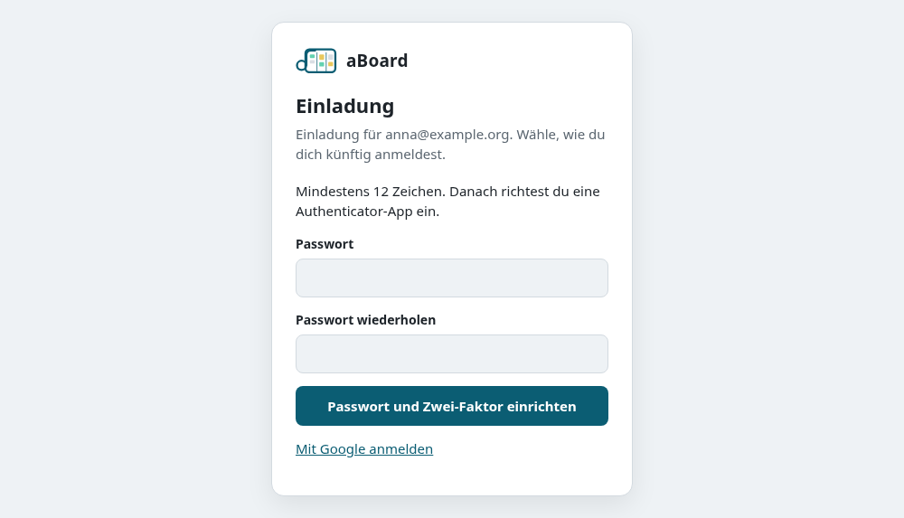

- **Set up password and two-factor:** You choose a password and set up an authenticator app on your phone. This is the way this section describes step by step.
- **Sign in with Google** (or another provider, for example "company account"): You sign in there with your existing account. You then need no password and no app at aBoard. Click the link, sign in at the provider and follow the instructions. The server connects your provider account with the invitation, even if the provider reports a different e-mail address; the admin sees this address before confirming. If your provider account already belongs to another access here, the page does not redeem the invitation; ask the admin in that case.

If the page shows only one way, take that one.

### Setting a password

1. Type a **password** of at least **12 characters**. A long sentence of several words is easy to remember and hard to guess. A password manager may remember it.
2. Type it a second time into the field "Passwort wiederholen" (repeat password).
3. Click **Passwort und Zwei-Faktor einrichten** (set up password and two-factor).

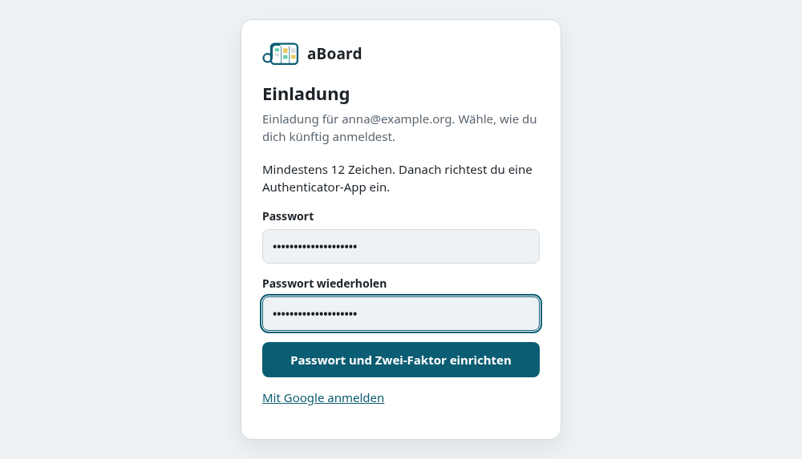

If the two entries do not match or the password is too short, the page tells you and you type again.

### Setting up the authenticator app

An **authenticator app** is a small program on your phone. Every 30 seconds it shows a new six-digit code. You need the code at every sign-in in addition to the password. This way nobody gets into your account with your password alone.

There are many such apps, for example Aegis Authenticator, 2FAS, Google Authenticator or Microsoft Authenticator. Any app that supports "time-based codes (TOTP)" works. Install one from your phone's app store if you do not have one yet.

The page "Authenticator-App einrichten" shows a **QR code** and below it the matching **key**:

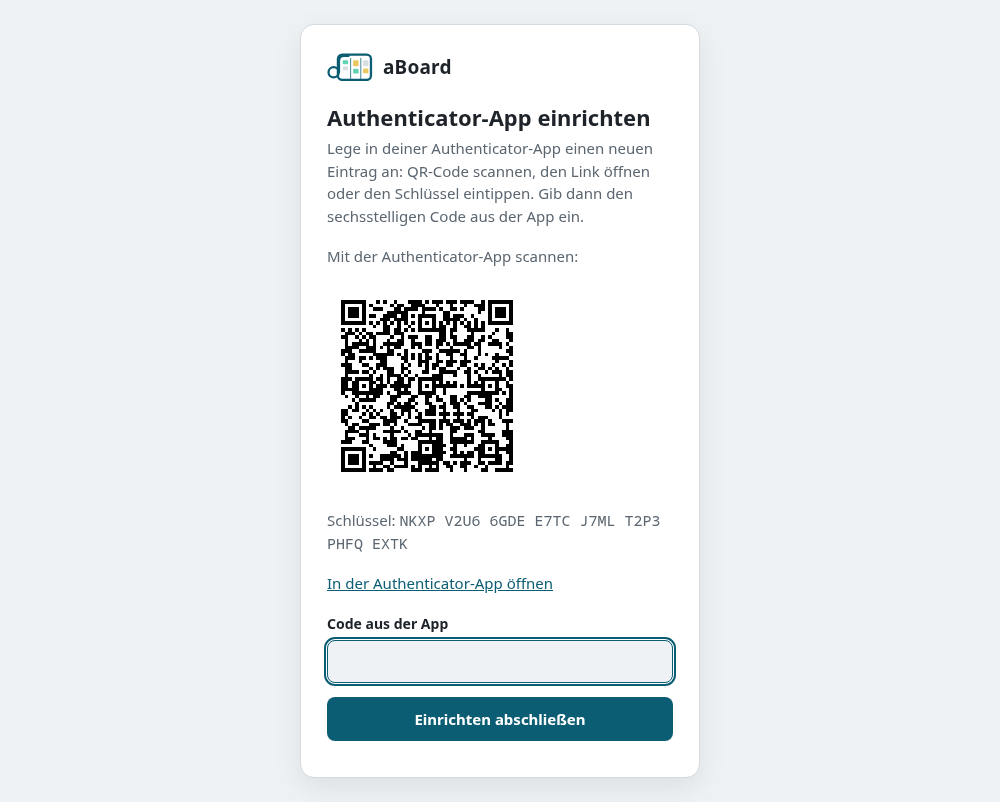

1. Open the app and create a **new entry** ("add account", usually a plus sign).
2. The easiest way is to **scan the QR code** at the top of the page with the app's camera. If that does not work (for example because you have the page open on the phone itself), enter the **key** from the page by hand instead. The groups of four characters are only for readability; most apps accept the key with or without spaces. "aBoard" is a fitting name. Leave everything else as the app suggests.
3. If you open the page **on the phone itself**, a tap on **In der Authenticator-App öffnen** (open in the authenticator app) also works. On a computer this link does not work; type the key there.
4. The app now shows a six-digit code for "aBoard". Type it into the field **Code aus der App** (code from the app) and click **Einrichten abschließen** (finish setup).

Only a correct code completes the setup. If the page says "Der Code stimmt nicht" (the code is wrong), wait until the app shows a new code and check the **time on your phone**: the codes depend on the clock and go wrong if it is off (best set it to "automatic"). If it takes longer than a quarter of an hour, the setup expires. Then open the invitation link again.

### Recovery codes: your emergency exit

After the correct code the page shows **ten recovery codes**:

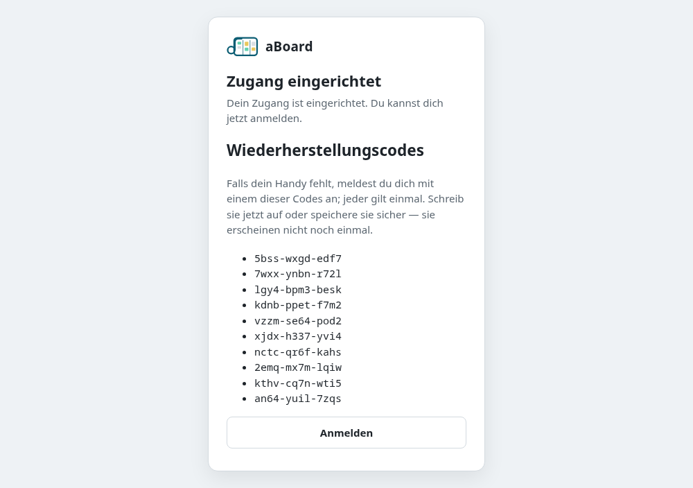

- A recovery code replaces the app code **once**. You need it when your phone is not at hand. Each code is valid **only once**.
- The page shows them **only now**. They will not be shown again later.
- **Keep them where they will not get lost together with the phone:** printed in a drawer or in your password manager. Do **not take a photo** that ends up in a cloud, and do not send them to yourself by e-mail or chat. Whoever has the codes and your password gets into your account.

Whether you can get in right away depends on the admin. If the page shows "Dein Zugang ist eingerichtet. Du kannst dich jetzt anmelden." (your access is set up, you can sign in now), you are activated (this applies to the very first person on a new server). Otherwise it says:

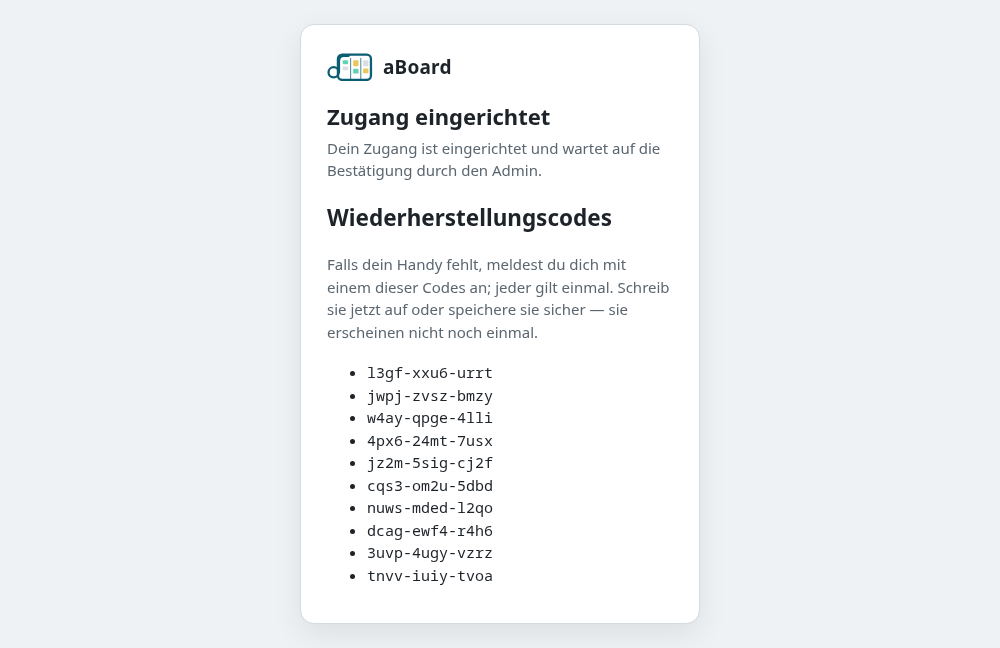

In this case let the admin know that you are done. As long as the admin has not confirmed, you cannot get in:

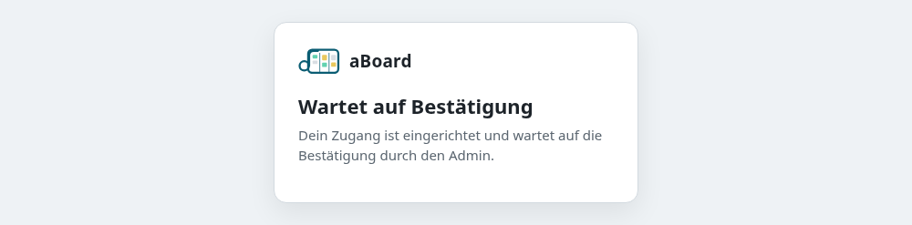

You also see this page if you sign in in the meantime. It is not an error.

### Signing in: password and code

Open the address of your board. If you have no valid session yet, you land on the sign-in page by yourself.

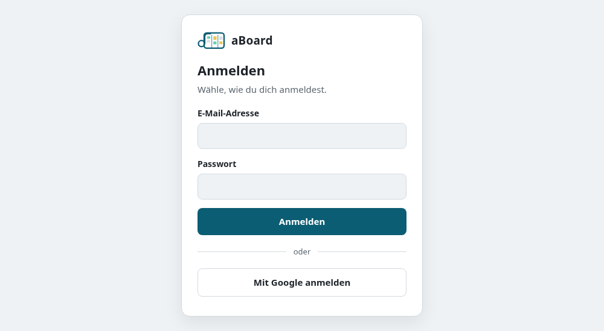

1. Enter your **e-mail address** (the one from the invitation) and your **password**, click **Anmelden** (sign in).
2. A second page "Anmelden" with the field "Code" follows. Enter the **six-digit code from the authenticator app**. A code is valid only once: if you have just used it, wait for the next one.
3. Click **Anmelden**. You are in and see your board.

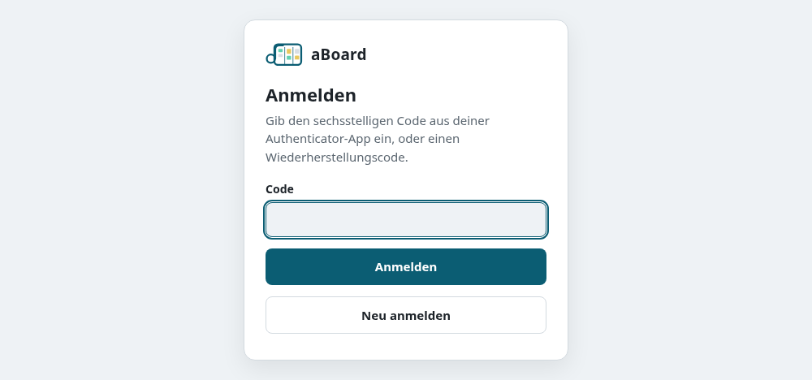

If your browser is set to English, the sign-in pages appear in English; the texts quoted here then read accordingly.

If the phone is not at hand, type a **recovery code** into the same field. It is used up afterwards. Cross it off your list.

What you may come across on the way:

| Message | What it means, what you do |
|---|---|
| "E-Mail-Adresse oder Passwort stimmt nicht." (e-mail address or password is wrong) | A typo or the wrong password. For security reasons the page does not say which of the two was wrong. |
| "Zu viele Versuche. Bitte … Sekunden warten …" (too many attempts, please wait … seconds) | Wait the stated time and try again. The waiting time grows with every failed attempt for this address. |
| "Zu viele Fehlversuche von diesem Anschluss. Bitte in … Minuten erneut versuchen." (too many failed attempts from this connection) | From your internet connection there were five wrong entries within 15 minutes (from you or from others on the same connection, for example in the same office network). Sign-in from this connection is then blocked for a few minutes. Wait the stated time or sign in from another network (for example via mobile data). |
| "Der Code stimmt nicht oder wurde schon benutzt." (the code is wrong or has already been used) | Wait for the app's next code and enter it. Check the phone's clock. |
| "Zu viele falsche Codes. Bitte noch einmal mit dem Passwort anmelden." (too many wrong codes, sign in with the password again) | After several wrong codes the sign-in starts again at the password. |
| "Die Anmeldung ist abgelaufen." (the sign-in has expired) | You took too long. Sign in again. |
| "Wartet auf Bestätigung" (waiting for confirmation) | The admin has not confirmed you yet. Ask the admin. |
| "Kein Zugang" (no access) | Your account is locked or not activated. Ask the admin. |

### Signing in through Google or another provider

If the server offers a provider, the sign-in page shows a link such as **Mit Google anmelden** (sign in with Google) or "Mit Firmen-Konto anmelden" (sign in with company account). Click it and sign in at the provider. If you already have a session there, you may get back into the board without any further input. On this way you need no password or code from aBoard; your provider handles the second factor.

This only works with the provider account that was connected with the invitation (or if the admin has approved your address in advance). Any other Google account does not get in.

### Phone gone or password forgotten

aBoard sends you **no** "forgot password" e-mail. This is intentional: nobody should be able to sneak in through someone else's mailbox. Instead the admin resets your account:

- **Phone lost, new phone or app deleted:** With a **recovery code** you get in once more. Afterwards you set up the app again yourself in the [account settings](#account-settings-change-them-yourself). If you have no recovery code left either, ask the admin to reset your account.
- **Password forgotten:** Ask the admin to reset your account. (You can *change* the password yourself as long as you still know it.)
- **Resetting** discards password, authenticator app and recovery codes. You get a **new invitation link** from the admin. The page then says "Dein Zugang … wurde zurückgesetzt. Wähle, wie du dich künftig anmeldest." (your access has been reset, choose how you will sign in). You go through the steps above once more, with a new password, a new entry in the app and new recovery codes. After that **your account again waits for the admin's confirmation**, as the first time. Tell the admin when you are done.
- If you have lost **everything** (phone, codes, password), the way is the same: ask the admin.

The page "Die Zwei-Faktor-Anmeldung dieses Zugangs ist nicht lesbar" (the two-factor sign-in of this access is not readable) or "Zwei-Faktor fehlt" (two-factor missing) means that the admin has to reset the account.

### Account settings: change them yourself

If your server manages sign-in itself, the menu (click on the **logo**) contains the entry **Konto-Einstellungen** (account settings). There you change without an admin:

- **Connect a further sign-in method**, for example Google in addition to the password, and **disconnect** a method again.
- **Change your password**.
- **Set up the authenticator app again** (new phone) and create **new recovery codes**.
- **End other sessions**, for example if you did not sign out somewhere.
- **Create your own password with an authenticator app** if so far you only sign in through Google or similar — only if the operator has switched this on for your server.

**Confirmation.** If you have a password, the top of the dialog shows a field "Bestätigung" (confirmation): there you enter your **current password** and a **code from your app** (or a recovery code). This applies to every change below it, so that nobody can rebuild your account at a computer left open. A code is valid only once: after a change you wait for the next code in the app (about 30 seconds). Several wrong entries lock the account settings for 15 minutes; the normal sign-in is not affected. Whether you have a password, the dialog shows you: then the field "Bestätigung" is at the top.

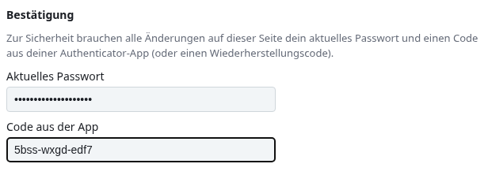

**Confirmation without a password: sign in again.** If you only sign in through Google or another provider, you have no password to confirm with. An open session alone is not enough for changes, otherwise someone could take over your account at your computer left open. Instead you confirm by **signing in at the provider once more**:

1. Click the change you want (for example **Lösen** (disconnect), **Verknüpfen** (connect) or **Passwort mit zweitem Faktor anlegen** (create password with second factor)). Directly at the button you clicked, a highlighted box "Für … melde dich erst neu an" (for … sign in again first) appears with the button **Erst bei Google neu anmelden** (sign in at Google again first), or your provider.
2. Click it. At the provider choose **the same account** you are signed in to aBoard with, and sign in. Some providers ask for the password again; Google usually does not if you are already signed in there.
3. Afterwards you are back in aBoard, the dialog opens and says "Du hast dich neu angemeldet" (you have signed in again). In the box at your change click **Jetzt ausführen** (do it now).

The confirmation is valid for **5 minutes**, **once** and **only for the change you chose**. If you sign in at the provider with a different account or it takes too long, the dialog says "nicht anerkannt" (not accepted) and nothing changes. This also happens if your last real sign-in at the provider was a while ago (common with Google, because Google does not ask for the password again): then sign out at the provider (at Google for example on accounts.google.com), sign in there again and try once more. If the dialog says "Dein Anmeldedienst bestätigt keine frische Anmeldung" (your sign-in service does not confirm a fresh sign-in) instead, your provider does not deliver this confirmation (usual with Google without a verified app). Signing out and in again does not help then; ask the person who runs the server: they can allow the confirmation with `ABOARD_OIDC_REAUTH_FALLBACK`. If the dialog says "Die Anmeldung beim Anbieter gehört nicht zu diesem Vorgang" (the sign-in at the provider does not belong to this process), signing out and in does not help either: start the confirmation again and follow the way to the provider in a single window. If you are not connected to any configured provider, a change is only possible through administration: ask the admin or the operator.

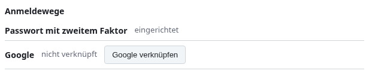

**Connecting a sign-in method.** Click **Verknüpfen** (connect) at the provider. You are redirected to the provider and choose the account there. Afterwards you land in aBoard again, and the dialog tells you whether it worked. Without a password you sign in again once beforehand (see above). A provider account can belong to **one** person; if it already belongs to someone else, nothing is connected. If you have already connected an account at this provider, the new one **replaces** the previous one (this is how you switch your Google account). Afterwards the session ends on all other devices; you stay signed in here. This is the answer to "I have a new Google account": connect the new account, done.

**Disconnecting a sign-in method.** Click **Lösen** (disconnect). Your **last** sign-in method can never be disconnected, otherwise you could no longer get in. Disconnecting also ends all other sessions; you stay signed in. If you have already lost access to your old provider account and therefore cannot get into the account settings, the operator helps (they can remove the binding; your boards and rights remain).

**Creating your own password.** If so far you only sign in through a provider and the operator has switched it on, the dialog shows the section **Passwort anlegen** (create password). Click **Passwort mit zweitem Faktor anlegen** and sign in at the provider again as described above. Afterwards you set up the authenticator app (scan the QR code or type the key), choose your password (at least 12 characters, twice) and enter the first code from the app. You receive **recovery codes** that appear only now: write them down or store them safely. (If the dialog says "bitte neu anmelden" (please sign in again) in the process, the password is valid nevertheless; write down the codes and sign in again.) From then on you sign in either with e-mail address, password and code or at the provider as before. All other sessions end; you stay signed in. If the section is missing, the function is switched off on your server.

**Changing the password.** Enter the new password twice (at least 12 characters) and click **Passwort ändern** (change password). All **other** sessions end; you yourself stay signed in.

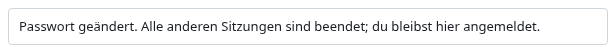

**Setting up the authenticator app again.** Click **2FA neu einrichten** (set up 2FA again): you see a new QR code and the key to type in. Set up the new app and enter the first code from it. **Only then** does the new app apply; until then the previous one keeps working. You receive **new recovery codes**, the old ones become invalid. The codes appear **only now**: write them down or store them safely. Here too all other sessions end.

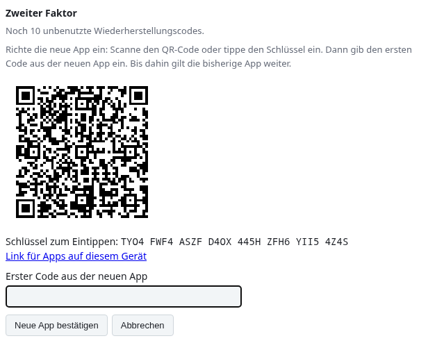

**New recovery codes.** If you only need new codes (the old ones are used up or lost), create them with **Neue Wiederherstellungscodes erzeugen** (create new recovery codes). The previous ones expire.

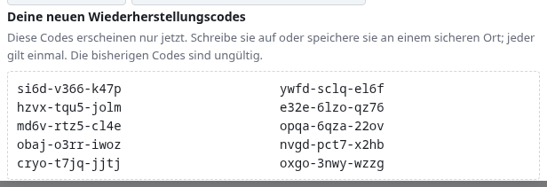

**Whoever has no password of their own** (access only through a provider, or approved in advance by the operator) only sees the sign-in methods and cannot change them here; password and second factor do not exist for this access. You can still end the other sessions.

### Signing out, especially on other people's computers

On your own computer you do not need to sign out. On a **foreign or shared computer** always sign out when you are done:

1. Click the **logo** at the top left. The menu opens.
2. Click **Abmelden** (sign out).

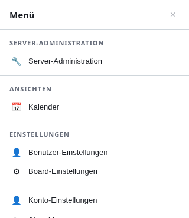

You see the page "Abgemeldet" (signed out):

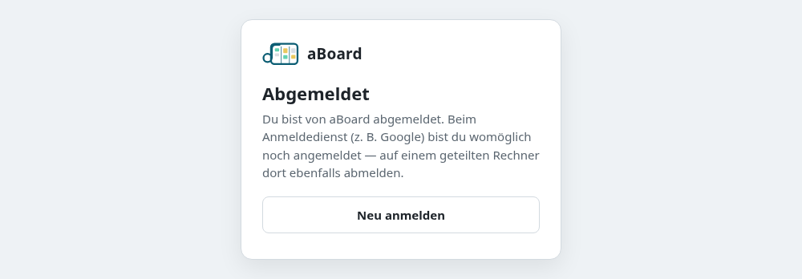

If you signed in through Google or another provider, you are **possibly still signed in** there. Sign out there as well. Otherwise the next person at the same computer can continue working in your name.

On other people's computers also:

- Do **not let the browser save** your password when it asks.
- Close the browser window after signing out.
- Never write your password or recovery codes into a file on that computer.

### For admins: a look at the other side

Whoever manages the accounts finds everything in the tab "User-Verwaltung" (user management) of the server administration (menu, entry "Server-Administration"). Inviting, confirming, locking and resetting are explained in [Server administration](server/administration.md#accounts-and-invitations-built-in-sign-in). For orientation, the pictures as the invited people experience them in the section above:

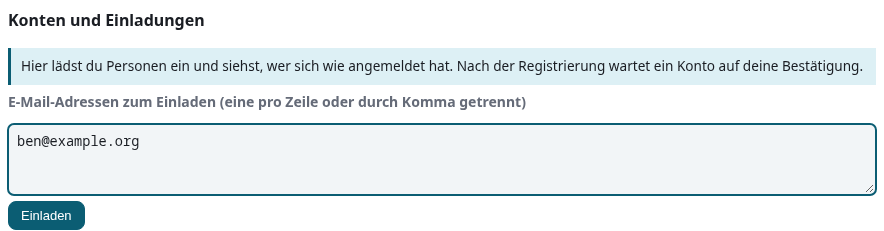

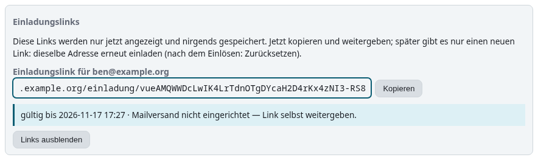

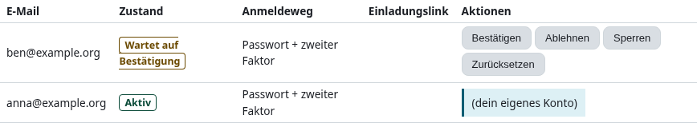

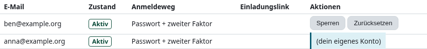

## Board in a folder (project mode)

With **Logo → Board Settings → "Choose folder…"**, aBoard puts the board into a folder as `aboard-sync.json` and regularly checks whether anything there has changed. This requires the **File System Access API** (Chrome, Edge and other Chromium browsers); after a browser restart, the browser asks once for permission. Never edit `aboard-sync.json` by hand, always use the board interface.

### The one-tab principle

**Keep only one browser tab with the board open at any time.**

As long as a tab is open, the browser holds its own interim storage (`localStorage`) with your latest editing state. If you open a second tab, for example because the first seems frozen, it brings its **own, possibly outdated** interim storage. If a state is restored or compared from it, this can look like a huge number of deleted cards, even though none of that was intended.

`aboard.html`, by contrast, has a built-in brake (the single file does not): a deletion that affects an unusually large number of cards (more than 20) or swimlanes (more than 2) at once triggers a safety prompt with the exact count before anything is written. The default of this prompt is "Cancel". The brake is an additional safety net, but no substitute for the rule: **one tab, one current state.**

In practice this means: before opening a new tab, really close the old one; do not just open a new window next to it.

## Further reading

- [Variants](variants.md) — what each operating mode can do
- [Server administration](server/administration.md#accounts-and-invitations-built-in-sign-in) — for admins: invitations, confirming, resetting
- [Installation](installation.md) — setting up and updating
