# Bedienung

[English](../handbook/usage.md) · **Deutsch**

Dieses Kapitel erklärt die Arbeit mit dem Board im Alltag: Spalten, Karten, Swimlanes, Filter, Kalender, Tastatur und die Anmeldung am Server. Einige Funktionen gibt es nur mit dem Mehrbenutzer-Server; das steht jeweils dabei.

Welche Variante du vor dir hast, erklärt [Varianten](varianten.md).

## In fünf Minuten: das Wichtigste

- aBoard zeigt ein **Kanban-Board**: Spalten mit Karten, die Aufgaben darstellen. Die Spalten bilden den Status ab, von links nach rechts.
- Als **Einzeldatei** ist aBoard eine einzige HTML-Datei: Doppelklick, im Browser öffnen, fertig. **Speichern** schreibt das Board in diese Datei.
- Mit einer **Ordner-Verbindung** liegt das Board als `aboard-sync.json` in einem Ordner. Du fasst die Datei dann nie von Hand an und hältst **nur einen Browser-Tab** mit dem Board offen.
- Auf einem **Server-Board** arbeitet ihr im Browser unter der Adresse des Servers; Änderungen anderer erscheinen von selbst. Wie du dich anmeldest und ein Konto bekommst, steht in [Anmelden und Konto](#anmelden-und-konto).
- Was du selbst steuerst: Karten in die richtige Spalte legen, Flags setzen, Fälligkeiten eintragen.

## Der Bildschirm

**Kopfzeile:** Logo, Board-Titel, Suchfeld, Filter, die Knöpfe **＋** (Spalte hinzufügen), **⊞** (Swimlane hinzufügen) und **Speichern**. Auf schmalen Bildschirmen wandern einige davon in das Menü **⋯**.

**Menü:** Ein Klick auf das **Logo** öffnet die Seitenleiste. Darin:

| Bereich | Inhalt |
|---|---|
| Datei | Öffnen, Exportieren (JSON) |
| Ansichten | Kalender |
| Einstellungen | **Benutzer-Einstellungen** (Identitäten, Theme hell/dunkel/System, Kartendichte, Darstellung — Ecken abgerundet oder eckig, Schrift System/Serif/Monospace, Akzentfarbe —, Sprache Deutsch/Englisch; gilt für dieses Gerät) und **Board-Einstellungen** (Modus und Projektordner, Board-Hintergrund, Vorlagen, Anhang-Grenzen) |
| Dokumentation | nur in `aboard.html` mit Ordner-Verbindung (Projekt-Modus): README und Wissens-Index des Projekts lesen |
| weitere | nur auf dem Server: Wissen (wenn eingerichtet), Server-Verwaltung (für Admins), Clients und Projekte |

Unten in der Seitenleiste steht die Version von aBoard.

**Darstellung:** Kästen sind von Haus aus **eckig**. Unter Benutzer-Einstellungen stellst du Ecken (abgerundet oder eckig), Schrift (System, Serif, Monospace) und Akzentfarbe (Petrol, Blau, Grün, Violett, Graphit) ein. Die Auswahl wirkt sofort als Vorschau; „Abbrechen“ nimmt sie zurück. Sie gilt für dieses Gerät und diesen Browser, nicht für alle am Board.

## Spalten

Ein frisches Board hat vier Spalten: **Backlog → Ready → In Arbeit → Erledigt**.

| Spalte | Bedeutung |
|---|---|
| Backlog | Ideen-Parkplatz: erfasst, aber noch nicht zur Bearbeitung freigegeben |
| Ready | Commitment-Point: das soll als Nächstes erledigt werden |
| In Arbeit | wird gerade bearbeitet |
| Erledigt | abgeschlossen |

Spalten lassen sich umbenennen (Klick auf den Titel), zuklappen, hinzufügen (**＋**) und löschen. Im Spaltenkopf gibt es außerdem Sammelaktionen: alle Karten der Spalte archivieren oder löschen. Gelöscht wird dabei in allen Swimlanes, deshalb fragt aBoard vorher nach.

Die Spaltennamen sind eine Vorgabe, keine feste Regel der Software.

## Swimlanes: Sprints und Lanes

Swimlanes sind waagerechte Zeilen durch das ganze Board. Jede Karte gehört zu genau einer Swimlane. Ganz oben liegt immer die Swimlane **Backlog** für alles, was keinem Sprint zugeordnet ist.

Mit **⊞** legst du eine neue Swimlane an und wählst die Art:

- **Sprint** — ein Arbeitsabschnitt mit Anfang und Ende. Jeder Sprint bekommt zwei Sonderkarten: **📋 Sprint-Start** für Anweisungen und Notizen zu Beginn, **🏁 Sprint-Abschluss** für den Rückblick am Ende. Sobald die erste Karte des Sprints den Backlog verlässt, wandert die Start-Karte beim Laden des Boards nach Erledigt; das zeigt an, dass der Sprint läuft. Der Sprint-Kopf zeigt den Fortschritt, etwa „3/8 Karten“, und sobald Aufwände geschätzt sind, erledigte gegen geschätzte Stunden.
- **Lane** — eine Themen- oder Personenzeile ohne Sprint-Mechanik: keine Sonderkarten, keine Fortschrittsanzeige.

Eine Swimlane lässt sich später zwischen Sprint und Lane umschalten, ein- und ausklappen und verschieben (am Griff ziehen oder mit den Pfeiltasten hoch/runter). Beim Löschen eines Sprints wandern seine Karten in den Backlog.

Die Sonderkarten 📋 und 🏁 lassen sich weder löschen noch verschieben noch archivieren; nur Beschreibung und Kommentare sind bearbeitbar.

**Swimlanes archivieren:** Über **📦** im Sprint-Kopf verschwindet eine ganze Swimlane aus dem Board. Ihre Karten bleiben unverändert erhalten. Mit dem Filter „Archiv anzeigen“ erscheint sie wieder, eingeklappt und mit dem Hinweis „Archiviert“.

## Karten

### Anlegen und verschieben

- **„+ Karte hinzufügen“** unten in einer Spalte, oder die Taste `n`. Gibt es Vorlagen, wählst du zuerst „Leer“ oder eine Vorlage.
- **Verschieben** per Drag & Drop, auch zwischen Swimlanes. Auf dem Smartphone funktioniert das ebenfalls.
- **Mehrere Karten zugleich:** Mit Strg-Klick (Mac: Cmd-Klick) Karten einzeln auswählen, mit Umschalt-Klick einen Bereich, mit `Strg+A` alle sichtbaren. Eine Leiste bietet dann Verschieben, Owner setzen, Label hinzufügen/entfernen und Löschen an. `Esc` hebt die Auswahl auf.

Jede Karte hat eine fortlaufende Nummer (`#12`), über die man sie eindeutig benennen kann.

### Das Karten-Fenster

Ein Klick auf eine Karte öffnet sie. Das Fenster hat mehrere Reiter:

| Reiter | Inhalt |
|---|---|
| Details | Titel, Beschreibung (Markdown), Labels |
| Kommentare | Kommentar-Verlauf; `Strg+Enter` schickt einen Kommentar ab |
| ⛓ Verknüpfungen | Verweise auf andere Karten |
| 📎 Anhänge | Dateien und Bilder |
| 📋 Verlauf | wer wann was geändert hat |
| 🤖 Agent-Kontext | nur im Projekt-Modus und auf dem Server, wenn Claude Owner oder beteiligt ist: ein Kontextpaket für KI-Agenten |

Darunter stehen die Felder der Karte (siehe nächster Abschnitt). Beim Schließen des Fensters speichert aBoard die Änderungen automatisch.

**Beschreibung:** Sie öffnet sich im Lesemodus. Der Knopf **✏** (Hinweis „Bearbeiten“) schaltet in den Bearbeitungsmodus: Ein Klick auf einen Absatz macht ihn editierbar, eine Werkzeugleiste hilft beim Formatieren (`Strg+B` fett, `Strg+I` kursiv, Überschriften, Listen, Checklisten, Links, Zitate). **„✓ Fertig“** schaltet zurück. Häkchen in Checklisten lassen sich auch im Lesemodus setzen. Bilder von fremden Servern lädt aBoard erst nach einem Klick, damit nichts unbemerkt ins Netz geht.

**Export einer Karte:** Das Menü „📄 Export“ im Karten-Fenster druckt die Karte bzw. speichert sie als PDF, speichert sie als Markdown oder öffnet eine E-Mail mit ihrem Inhalt.

### Karten-Felder

| Feld | Bedeutung |
|---|---|
| **Priorität** | Niedrig, Mittel, Hoch |
| **Labels** | freie Schlagworte, durch Komma getrennt, etwa `bug, feature` |
| **Owner** | wer die Karte verantwortet: eine Person oder, im Projekt-Modus und auf dem Server, ein Claude-Modell |
| **Beteiligte** | weitere Personen oder Modelle, die mitwirken |
| **Komplexität** (`einfach`/`mittel`/`hoch`) | wie aufwendig die Aufgabe grob eingeschätzt wird — nur im Projekt-Modus und auf dem Server |
| **Aufwand (h)** | geschätzte Stunden, etwa `0.5` — nur im Projekt-Modus und auf dem Server |
| **⚡ Kritisch** | die Karte ist dringend und blockiert den Fortschritt |
| **⊘ Blockiert** | die Karte wartet auf etwas anderes (eine Antwort, ein externes System) |
| **✓ QA** („QA abgeschlossen“) | die Karte wurde geprüft und ist abnahmebereit |
| **Fällig am** | ein Termin; optional mit Uhrzeit |
| **Start am** | ein Starttermin; optional mit Uhrzeit, nur zur Information |
| **Wiederkehrend** | täglich, wöchentlich (mit Wochentag) oder monatlich (mit Tag im Monat) |

Komplexität und Aufwand helfen, eine Aufgabe realistisch einzuschätzen, bevor sie losgeht; die Kachel zeigt beide als kleine Plaketten. Die Flags Kritisch, Blockiert und QA sind einfache Ja/Nein-Schalter, sichtbar als Symbole auf der Karte.

**Fälligkeit:** Eine überfällige Karte bekommt eine rote Plakette, eine in den nächsten drei Tagen fällige eine gelbe. In der Spalte Erledigt entfällt die Plakette.

**Owner und Identitäten:** Welche Namen im Owner-Feld zur Wahl stehen, legst du unter Benutzer-Einstellungen → Identitäten fest (Anzeigename, Farbe). Auf einem Server-Board bietet das Owner-Feld stattdessen die Personen an, die eine Rolle am Board haben; Claude-Modelle nur auf Boards, die sie schon nutzen.

### Wiederkehrende Karten

Eine Karte mit Wiederholung ist eine Vorlage, die im Board stehen bleibt. Fällt der nächste Termin an, legt aBoard beim Laden des Boards eine neue Karte als Kopie an. Die Kopien tragen selbst keine Wiederholung.

### Vorlagen

Im Karten-Fenster speichert **„Als Template speichern“** eine Karte als Vorlage. Beim Anlegen einer neuen Karte erscheint die Vorlage dann zur Auswahl. Verwaltet werden Vorlagen in den Board-Einstellungen.

### Verweise zwischen Karten

Im Reiter **⛓ Verknüpfungen** verbindest du Karten miteinander:

| Typ | Gegenstück auf der anderen Karte | Bedeutung |
|---|---|---|
| blockiert | blockiert von | diese Karte hält die andere auf |
| blockiert von | blockiert | diese Karte wartet auf die andere |
| hängt ab von | Voraussetzung für | weiche Abhängigkeit, parallel bearbeitbar |
| Voraussetzung für | hängt ab von | die andere Karte braucht diese |
| verwandt mit | verwandt mit | nur zur Information |

aBoard trägt das Gegenstück auf der anderen Karte automatisch ein. Eine Karte mit offenem „blockiert von“ zeigt die Plakette ⛔. Verschiebst du sie trotzdem, fragt aBoard nach. Wird die blockierende Karte erledigt, meldet aBoard, dass die andere jetzt frei ist.

### Anhänge

Im Reiter **📎 Anhänge** fügst du Dateien hinzu: über „Datei wählen…“ oder per Drag & Drop auf das Fenster. Ein Bild kann als **Cover** der Karte dienen und erscheint dann auf der Kachel.

Wo die Dateien landen, hängt von der Variante ab:

- **Einzeldatei:** in der HTML-Datei selbst. Deshalb gibt es Grenzen für die einzelne Datei und für die Gesamtgröße des Boards (einstellbar in den Board-Einstellungen). Große Anhänge machen die Datei träge.
- **Projekt-Modus:** im Unterordner `attachments/` des Projektordners.
- **Server:** auf dem Server. Dort lassen sich Dateien auch an Kommentare hängen. Löschen geht nur, solange der Server erreichbar ist und du angemeldet bist: Klappt es nicht, bleibt der Anhang in der Karte und ein Hinweis sagt, warum (ohne Berechtigung oder später erneut versuchen). Löschst du eine ganze Karte, während der Server nicht antwortet oder deine Anmeldung abgelaufen ist, versucht aBoard das Entfernen ihrer Dateien noch einmal, sobald dein Löschen am Server angekommen ist — solange der Tab offen bleibt. Schließt du ihn vorher, bleiben die Dateien am Server liegen.

### Archivieren

Erledigte Karten, die du nicht mehr sehen willst, aber behalten möchtest, archivierst du (**📦 Archivieren** im Karten-Fenster, oder für eine ganze Spalte im Spaltenkopf). Archivierte Karten verschwinden aus der Spalte, bleiben aber erhalten und im Export enthalten. Der Spaltenkopf zeigt mit 📦 und einer Zahl, wie viele dort liegen. Die Sonderkarten 📋 und 🏁 lassen sich nicht archivieren.

## Suchen und filtern

**Suche:** Taste `/` oder Klick ins Suchfeld. Gesucht wird ohne Rücksicht auf Groß- und Kleinschreibung in Titel, Beschreibung, Kommentaren, Labels und Owner. Karten ohne Treffer werden ausgeblendet, Treffer hervorgehoben. Ein Kreuz im Feld setzt die Suche zurück.

**Filter:** In der Kopfzeile filterst du nach Owner (trifft auch Beteiligte), nach Label sowie nach den Flags ⚡ Kritisch und ⊘ Blockiert. Anders als die Suche blendet der Filter nicht aus, sondern **dimmt** die nicht passenden Karten; so bleibt der Zusammenhang sichtbar. Der Schalter „Archiv anzeigen“ blendet archivierte Karten und Swimlanes ein.

Suche und Filter werden nicht gespeichert; nach dem Neuladen ist alles wieder sichtbar.

## Kalender

**Menü → Ansichten → Kalender** zeigt alle Karten mit Fälligkeits- oder Startdatum. Es gibt drei Ansichten: **Monat**, **Woche** und **Agenda** (die nächsten 30 Tage). Karten mit Uhrzeit erscheinen zur jeweiligen Zeit.

- Eine Karte auf einen anderen Tag **ziehen** verschiebt ihre Termine.
- Ein Klick in einen leeren Tag legt eine **neue Karte** mit diesem Datum an.
- Filter: erledigte Karten zeigen, nach Owner einschränken.

Nur auf dem Server zusätzlich:

- **Alle Boards** — der Kalender zeigt Karten aus allen Boards, die du lesen darfst,
- **Termine ohne Karte** — „＋ Termin“ legt einen reinen Termin an (Titel, Datum, ggf. mehrtägig, von/bis, Ort, Beschreibung),
- **Abonnieren** — eine geheime Kalender-Adresse für Kalender-Apps,
- Filter nach Projekt.

## Board-Übersicht und mehrere Boards

Ein Klick auf den Board-Titel im Kopf öffnet ein Menü mit dem aktuellen und den zuletzt benutzten Boards; „Alle Boards anzeigen…“ zeigt die volle Liste. Der Stift ✎ neben dem Titel benennt das Board um. Auf dem Server gibt es dort außerdem „Neues Board“.

**Reiter:** Wer mehrere Boards nutzt, sieht unter dem Kopf eine Reiterleiste mit den zuletzt benutzten Boards, höchstens sechs. Ein Klick auf einen Reiter wechselt das Board; das aktuelle ist hervorgehoben. Neue Boards kommen hinten dazu, und bei mehr als sechs fällt das am längsten nicht benutzte heraus. Das × an einem Reiter nimmt ihn aus der Leiste, das Board selbst bleibt. Die Leiste merkt sich jeder Browser für sich. Mit nur einem Board erscheint sie nicht. Es gibt sie auf dem Server und im Claude-Code-Modus, nicht im einzelnen Datei-Board (Vorlage `aboard.template.html`). Auf dem Server zeigt ein Reiter ein **💬**, wenn Claude auf diesem Board auf deine Antwort wartet; die Frage selbst steht im Banner, sobald du das Board öffnest. Der Reiter wird höchstens einmal je Minute aufgefrischt.

Auf einem **Server-Board** öffnet „Alle Boards anzeigen…“ die **Board-Übersicht**: alle Boards, die du sehen darfst, als Kacheln mit Hintergrundbild, getrennt nach „Eigene“ und „Mit mir geteilt“. Jede Kachel nennt Rolle, Änderungsdatum und die Board-ID, die sich per Knopf kopieren lässt. Freigeben lässt sich ein Board in den Board-Einstellungen im Abschnitt „Freigabe“.

## Tastatur

| Taste | Wirkung |
|---|---|
| `/` | Suchfeld fokussieren |
| `n` | neue Karte in der ersten sichtbaren Spalte |
| `j` / `k` | nächste / vorherige Karte markieren |
| `Enter` | markierte Karte öffnen |
| `Esc` | Mehrfachauswahl aufheben, sonst Markierung aufheben bzw. Hilfe schließen |
| `?` | Übersicht der Tastenkürzel öffnen/schließen |
| `Strg+A` / `Cmd+A` | alle sichtbaren Karten auswählen |

Die Kürzel wirken nicht, solange ein Eingabefeld den Fokus hat oder ein Karten-Fenster offen ist. Im Karten-Fenster gelten eigene Kürzel: `Esc` schließt, `Strg+B`/`Strg+I` formatieren, `Strg+Enter` schickt einen Kommentar ab.

## Speichern, Öffnen, Exportieren

| | Einzeldatei | Projekt-Modus | Server |
|---|---|---|---|
| **automatisch** | Zwischenstand im Browser-Speicher | jede Änderung landet im Projektordner | jede Änderung landet auf dem Server |
| **Speichern** | schreibt Board und App in die HTML-Datei | schreibt in den Projektordner | — |
| **Öffnen** | lädt ein Board aus JSON- oder aBoard-HTML-Datei | wie Einzeldatei | — |
| **Exportieren** | JSON-Datei | JSON-Datei | JSON-Datei |

In der Einzeldatei gibt es außerdem den Knopf **KI-Kontext** unten links im Einstellungsdialog: Er erzeugt eine Markdown-Zusammenfassung des Boards (`ki-kontext.md`) zum Weitergeben an ein Sprachmodell.

Findet die Einzeldatei beim Öffnen ungespeicherte Änderungen aus der letzten Sitzung, bietet sie an, diese zu laden oder zu verwerfen.

Manchmal liegt im Browser noch eine ältere Zwischenkopie, also ein Zwischenstand, den sich der Browser gemerkt hat. Was dann passiert, hängt davon ab, wie du arbeitest:

- **Einzeldatei:** Beim Öffnen erscheint der Hinweis „Nicht gespeicherte Änderungen der letzten Session gefunden.“ mit den Knöpfen „Laden“ und „Verwerfen“.
- **Mit verbundenem Projektordner:** Maßgeblich ist der Stand im Projektordner. Ist dort ein Board, verschwindet die alte Browser-Kopie still, ohne Meldung. Nur wenn die Projektdatei gerade nicht lesbar ist oder fehlt, erscheint der Hinweis „Der Projektordner konnte gerade nicht gelesen werden. Im Browser liegt noch eine ältere Zwischenkopie — sie bleibt erhalten; maßgeblich ist weiter der Projektordner.“ mit dem Knopf „Alles klar“.
- **Projektordner bekannt, aber noch nicht freigegeben:** Dann erscheint nur der Hinweis zur Freigabe des Projektordners mit „Erlauben“. Bis zur Freigabe bleibt das Board leer; die Browser-Kopie bleibt dabei unangetastet. Das Banner verschwindet erst, wenn der Ordner verbunden ist. Antwortet der Browser auf die Freigabe nicht, steht dort „Der Browser antwortet nicht auf die Freigabe des Projektordners. Wähle den Ordner bitte neu.“ mit dem Knopf „Ordner neu wählen“.

Auf dem Server warnt aBoard, wenn jemand anderes das Board gleichzeitig geändert hat, und lässt dich wählen: eigene Version behalten oder die des Servers laden.

## Anmelden und Konto

Dieser Abschnitt gilt für ein **Server-Board**, wenn der Server Konten selbst verwaltet (eingebaute Anmeldung). Dann kommst du mit einer **Einladung** herein. Ob dein Server so eingerichtet ist, sagt dir die Person, die ihn betreibt. Wie du Einladungen als Admin verschickst, steht in [Server verwalten](server/administration.md#konten-und-einladungen-eingebaute-anmeldung). Die Bilder unten zeigen einen Testserver mit erfundenen Adressen (`example.org`).

Kurz gesagt:

1. Ein Admin lädt deine E-Mail-Adresse ein und schickt dir einen **Link**.
2. Du öffnest den Link und wählst, wie du dich künftig anmeldest: mit **Passwort und Authenticator-App** oder über einen **Anbieter** wie Google.
3. Ein Admin **bestätigt** deinen Zugang. Danach kannst du dich anmelden.

Es gibt keine Selbstregistrierung. Ohne Einladung kommst du nicht herein.

### Einladung annehmen und den Weg wählen

Der Link sieht aus wie `https://board.example.org/einladung/…` (die Adresse deines Servers) und gilt **sieben Tage** und **nur einmal**. Gib ihn niemandem weiter: Wer ihn zuerst einlöst, bekommt den Zugang. Ist er abgelaufen oder schon benutzt, zeigt die Seite „Link nicht gültig“. Dann bitte den Admin um einen neuen Link.

Die Seite nennt oben die Adresse, für die die Einladung gilt, und bietet je nach Server einen oder mehrere Wege an:

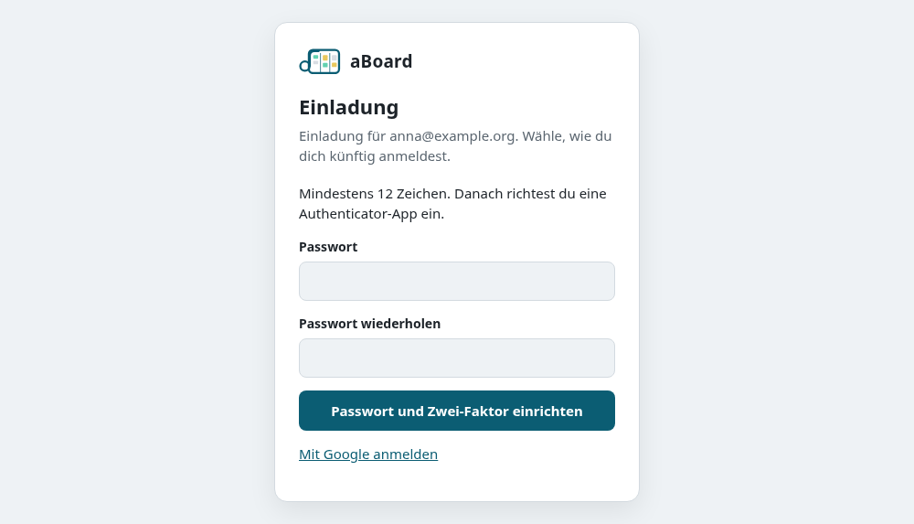

- **Passwort und Zwei-Faktor einrichten:** Du denkst dir ein Passwort aus und richtest eine Authenticator-App auf deinem Handy ein. Das ist der Weg, den dieser Abschnitt Schritt für Schritt beschreibt.
- **Mit Google anmelden** (oder ein anderer Anbieter, etwa „Firmen-Konto“): Du meldest dich dort mit deinem bestehenden Konto an. Ein Passwort und eine App bei aBoard brauchst du dann nicht. Klicke auf den Link, melde dich beim Anbieter an und folge den Hinweisen. Der Server verbindet dein Anbieter-Konto mit der Einladung, auch wenn der Anbieter eine andere E-Mail-Adresse meldet; der Admin sieht diese Adresse vor der Bestätigung. Gehört dein Anbieter-Konto hier schon zu einem anderen Zugang, löst die Seite nicht ein; frag dann den Admin.

Zeigt die Seite nur einen Weg, nimmst du den.

### Passwort setzen

1. Tippe ein **Passwort** ein, mindestens **12 Zeichen**. Ein langer Satz aus mehreren Wörtern ist gut zu merken und schwer zu erraten. Ein Passwortmanager darf es sich merken.
2. Tippe es ein zweites Mal ins Feld „Passwort wiederholen“.
3. Klicke auf **Passwort und Zwei-Faktor einrichten**.

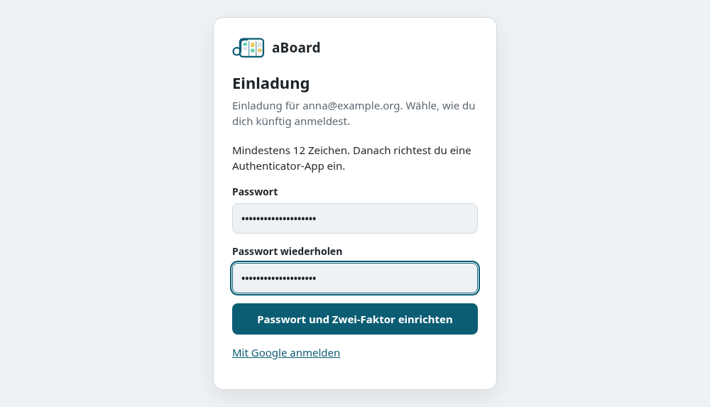

Stimmen die beiden Eingaben nicht überein oder ist das Passwort zu kurz, sagt die Seite es dir, und du tippst neu.

### Authenticator-App einrichten

Eine **Authenticator-App** ist ein kleines Programm auf dem Handy. Sie zeigt alle 30 Sekunden einen neuen sechsstelligen Code. Du brauchst den Code bei jeder Anmeldung zusätzlich zum Passwort. So kommt niemand mit deinem Passwort allein in dein Konto.

Es gibt viele solche Apps, zum Beispiel Aegis Authenticator, 2FAS, Google Authenticator oder Microsoft Authenticator. Jede, die „zeitbasierte Codes (TOTP)“ kann, funktioniert. Installiere eine aus dem App-Store deines Handys, falls du noch keine hast.

Die Seite „Authenticator-App einrichten“ zeigt einen **QR-Code** und darunter den zugehörigen **Schlüssel**:

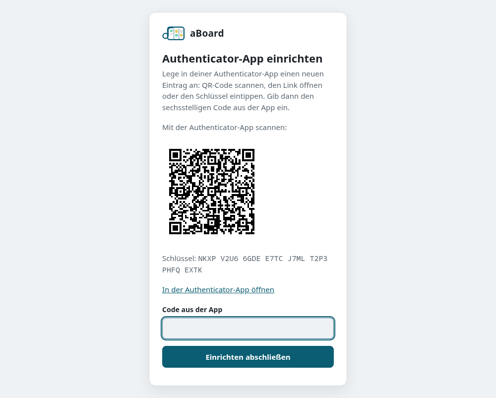

1. Öffne die App und lege einen **neuen Eintrag** an („Konto hinzufügen“, meist ein Plus-Zeichen).
2. Am einfachsten **scannst du den QR-Code** oben auf der Seite mit der Kamera der App. Klappt das nicht (etwa weil du die Seite auf dem Handy selbst offen hast), gib stattdessen den **Schlüssel** von der Seite von Hand ein. Die Gruppen aus vier Zeichen sind nur zum besseren Lesen; die meisten Apps nehmen den Schlüssel mit oder ohne Leerzeichen. Als Name passt „aBoard“. Alles andere lässt du, wie die App es vorschlägt.
3. Öffnest du die Seite **auf dem Handy selbst**, geht es auch mit einem Tipp auf **In der Authenticator-App öffnen**. Auf dem Rechner geht dieser Link nicht; dort tippst du den Schlüssel ab.
4. Die App zeigt jetzt einen sechsstelligen Code für „aBoard“. Tippe ihn ins Feld **Code aus der App** und klicke auf **Einrichten abschließen**.

Erst mit einem richtigen Code ist die Einrichtung fertig. Sagt die Seite „Der Code stimmt nicht“, warte, bis die App einen neuen Code zeigt, und prüfe die **Uhrzeit deines Handys**: Die Codes hängen an der Uhr und gehen falsch, wenn sie nicht stimmt (am besten „automatisch“ einstellen). Dauert es länger als eine Viertelstunde, ist die Einrichtung abgelaufen. Öffne dann den Einladungslink noch einmal.

### Wiederherstellungscodes: dein Notausgang

Nach dem richtigen Code zeigt die Seite **zehn Wiederherstellungscodes**:

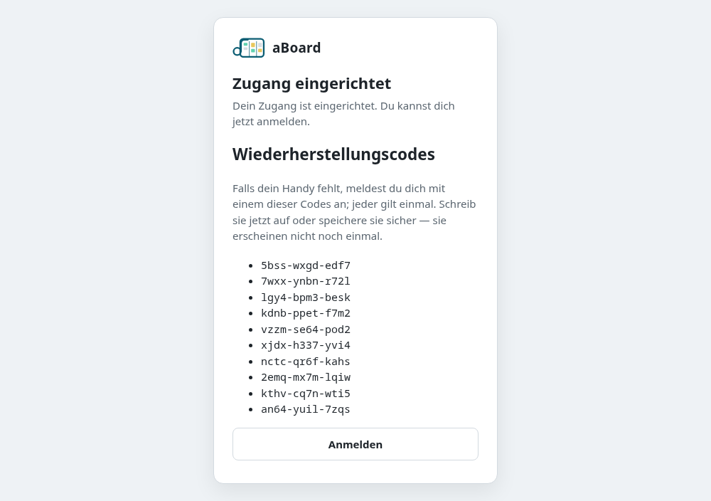

- Ein Wiederherstellungscode ersetzt **einmal** den App-Code. Du brauchst ihn, wenn dein Handy nicht da ist. Jeder Code gilt **nur einmal**.
- Die Seite zeigt sie **nur jetzt**. Später gibt es sie nicht noch einmal.
- **Bewahre sie so auf, dass sie nicht mit dem Handy verloren gehen:** ausgedruckt in einer Schublade oder in deinem Passwortmanager. Mach **kein Foto**, das in einer Cloud landet, und schick sie dir nicht selbst per Mail oder Chat. Wer die Codes und dein Passwort hat, kommt in dein Konto.

Ob du schon jetzt hereinkommst, hängt vom Admin ab. Zeigt die Seite „Dein Zugang ist eingerichtet. Du kannst dich jetzt anmelden.“, bist du freigeschaltet (das gilt für die allererste Person auf einem neuen Server). Sonst steht dort:

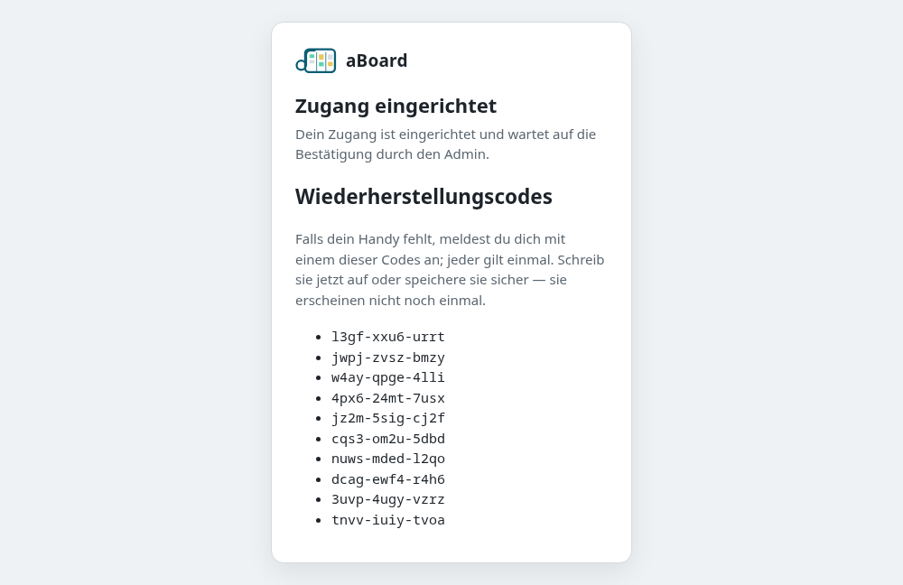

In diesem Fall gib dem Admin Bescheid, dass du fertig bist. Solange er nicht bestätigt hat, kommst du nicht herein:

Diese Seite siehst du auch, wenn du dich in der Zwischenzeit anmeldest. Sie ist kein Fehler.

### Anmelden: Passwort und Code

Öffne die Adresse deines Boards. Hast du noch keine gültige Sitzung, landest du von selbst auf der Anmeldeseite.

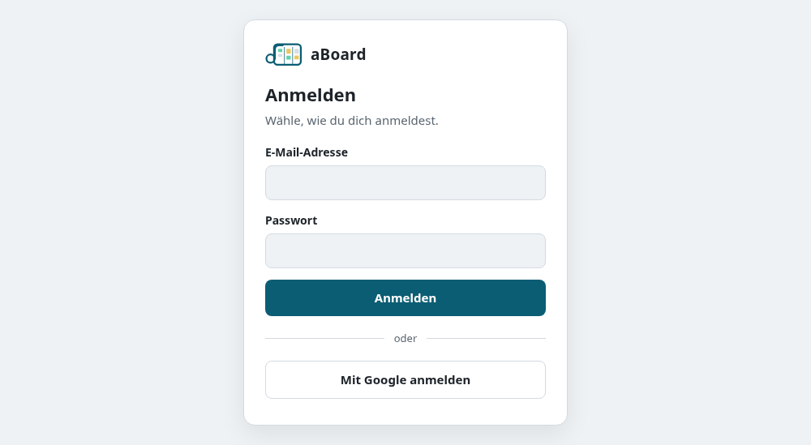

1. Gib deine **E-Mail-Adresse** (die der Einladung) und dein **Passwort** ein, klicke auf **Anmelden**.
2. Es folgt eine zweite Seite „Anmelden“ mit dem Feld „Code“. Gib den **sechsstelligen Code aus der Authenticator-App** ein. Ein Code gilt nur einmal: Hast du ihn gerade benutzt, warte auf den nächsten.
3. Klicke auf **Anmelden**. Du bist drin und siehst dein Board.

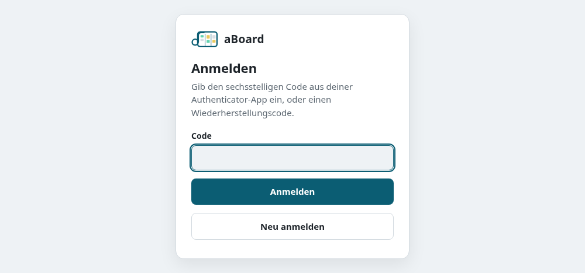

Ist dein Browser auf Englisch eingestellt, erscheinen die Anmeldeseiten auf Englisch; die hier zitierten Texte lauten dann sinngemäß gleich.

Ist das Handy nicht zur Hand, tippst du in dasselbe Feld einen **Wiederherstellungscode**. Er ist danach verbraucht. Streiche ihn auf deiner Liste durch.

Was dir unterwegs begegnen kann:

| Meldung | Was sie heißt, was du tust |
|---|---|
| „E-Mail-Adresse oder Passwort stimmt nicht.“ | Tippfehler oder falsches Passwort. Aus Sicherheitsgründen sagt die Seite nicht, was von beidem falsch war. |
| „Zu viele Versuche. Bitte … Sekunden warten …“ | Warte die genannte Zeit und versuche es noch einmal. Die Wartezeit wächst mit jedem Fehlversuch für diese Adresse. |
| „Zu viele Fehlversuche von diesem Anschluss. Bitte in … Minuten erneut versuchen.“ | Von deinem Internetanschluss aus gab es fünf falsche Eingaben innerhalb von 15 Minuten (von dir oder von anderen am selben Anschluss, etwa im selben Büro-Netz). Dann ist die Anmeldung von diesem Anschluss aus für einige Minuten gesperrt. Warte die genannte Zeit ab oder melde dich von einem anderen Netz aus an (zum Beispiel per Mobilfunk). |
| „Der Code stimmt nicht oder wurde schon benutzt.“ | Warte auf den nächsten Code der App und gib ihn ein. Prüfe die Uhr des Handys. |
| „Zu viele falsche Codes. Bitte noch einmal mit dem Passwort anmelden.“ | Nach mehreren falschen Codes beginnt die Anmeldung wieder beim Passwort. |
| „Die Anmeldung ist abgelaufen.“ | Du hast zu lange gebraucht. Melde dich noch einmal an. |
| „Wartet auf Bestätigung“ | Der Admin hat dich noch nicht bestätigt. Frag ihn. |
| „Kein Zugang“ | Dein Konto ist gesperrt oder nicht freigeschaltet. Frag den Admin. |

### Anmelden über Google oder einen anderen Anbieter

Bietet der Server einen Anbieter an, steht auf der Anmeldeseite ein Link wie **Mit Google anmelden** (oder „Mit Firmen-Konto anmelden“). Klicke darauf und melde dich beim Anbieter an. Hast du dort schon eine Sitzung, kann es ohne weitere Eingabe zurück ins Board gehen. Ein Passwort oder einen Code von aBoard brauchst du auf diesem Weg nicht; den zweiten Faktor regelt dein Anbieter.

Das klappt nur mit dem Anbieter-Konto, das bei der Einladung verbunden wurde (oder wenn der Admin deine Adresse vorab freigegeben hat). Ein beliebiges anderes Google-Konto kommt nicht herein.

### Handy weg oder Passwort vergessen

aBoard schickt dir **keine** „Passwort vergessen“-Mail. Das ist Absicht: Niemand soll sich über ein fremdes Postfach hereinmogeln können. Stattdessen setzt der Admin dein Konto zurück:

- **Handy verloren, neues Handy oder App gelöscht:** Mit einem **Wiederherstellungscode** kommst du noch einmal herein. Danach richtest du die App in den [Konto-Einstellungen](#konto-einstellungen-selbst-ändern) selbst neu ein. Hast du auch keinen Wiederherstellungscode mehr, bitte den Admin, dein Konto zurückzusetzen.
- **Passwort vergessen:** Bitte den Admin, dein Konto zurückzusetzen. (Das Passwort *ändern* kannst du selbst, solange du es noch kennst.)
- **Zurücksetzen** verwirft Passwort, Authenticator-App und Wiederherstellungscodes. Du bekommst vom Admin einen **neuen Einladungslink**. Die Seite sagt dann „Dein Zugang … wurde zurückgesetzt. Wähle, wie du dich künftig anmeldest.“ Du gehst die Schritte von oben noch einmal durch, mit einem neuen Passwort, einem neuen Eintrag in der App und neuen Wiederherstellungscodes. Danach **wartet dein Konto wieder auf die Bestätigung** des Admins, wie beim ersten Mal. Melde dich beim Admin, wenn du fertig bist.
- Hast du **alles** verloren (Handy, Codes, Passwort), ist der Weg derselbe: Admin fragen.

Die Seite „Die Zwei-Faktor-Anmeldung dieses Zugangs ist nicht lesbar“ oder „Zwei-Faktor fehlt“ bedeutet, dass der Admin das Konto zurücksetzen muss.

### Konto-Einstellungen: selbst ändern

Wenn dein Server die Anmeldung selbst verwaltet, findest du im Menü (Klick auf das **Logo**) den Eintrag **Konto-Einstellungen**. Dort änderst du ohne Admin:

- **Einen weiteren Anmeldeweg verknüpfen**, zum Beispiel Google zusätzlich zum Passwort, und einen Weg wieder **lösen**.
- Dein **Passwort ändern**.
- Die **Authenticator-App neu einrichten** (neues Handy) und **neue Wiederherstellungscodes** erzeugen.
- **Andere Sitzungen beenden**, etwa wenn du dich irgendwo nicht abgemeldet hast.
- Ein **eigenes Passwort mit Authenticator-App anlegen**, wenn du dich bisher nur über Google o. Ä. anmeldest — nur, wenn der Betreiber das auf deinem Server eingeschaltet hat.

**Bestätigung.** Hast du ein Passwort, steht oben im Dialog ein Feld „Bestätigung“: Dort gibst du dein **aktuelles Passwort** und einen **Code aus deiner App** (oder einen Wiederherstellungscode) ein. Das gilt für jede Änderung darunter, damit niemand mit einem offen gelassenen Rechner dein Konto umbauen kann. Ein Code gilt nur einmal: Nach einer Änderung wartest du auf den nächsten Code in der App (etwa 30 Sekunden). Mehrere falsche Eingaben sperren die Konto-Einstellungen für 15 Minuten; die normale Anmeldung bleibt davon unberührt. Ob du ein Passwort hast, zeigt dir der Dialog: Dann steht oben das Feld „Bestätigung“.

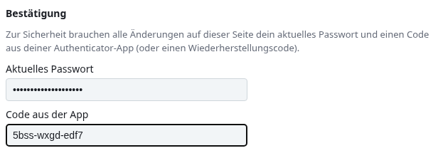

**Bestätigung ohne Passwort: neu anmelden.** Meldest du dich nur über Google oder einen anderen Anbieter an, hast du kein Passwort zum Bestätigen. Eine offene Sitzung allein reicht für Änderungen nicht, sonst könnte jemand mit deinem offen gelassenen Rechner dein Konto übernehmen. Stattdessen bestätigst du, indem du dich **beim Anbieter noch einmal anmeldest**:

1. Klicke auf die Änderung, die du willst (zum Beispiel **Lösen**, **Verknüpfen** oder **Passwort mit zweitem Faktor anlegen**). Direkt beim angeklickten Knopf erscheint ein farbig hervorgehobener Kasten „Für … melde dich erst neu an“ mit dem Knopf **Erst bei Google neu anmelden** (bzw. deinem Anbieter).
2. Klicke darauf. Wähle beim Anbieter **dasselbe Konto**, mit dem du in aBoard angemeldet bist, und melde dich an. Manche Anbieter fragen dabei neu nach dem Passwort; Google tut das meist nicht, wenn du dort schon angemeldet bist.
3. Danach bist du zurück in aBoard, der Dialog öffnet sich und sagt „Du hast dich neu angemeldet“. Klicke im Kasten bei deiner Änderung auf **Jetzt ausführen**.

Die Bestätigung gilt **5 Minuten**, **einmal** und **nur für die Änderung, die du gewählt hast**. Meldest du dich beim Anbieter mit einem anderen Konto an oder dauert es zu lange, sagt der Dialog „nicht anerkannt“, und es ändert sich nichts. Das passiert auch, wenn deine letzte echte Anmeldung beim Anbieter schon länger zurückliegt (bei Google häufig, weil Google nicht neu nach dem Passwort fragt): Melde dich dann beim Anbieter ab (bei Google zum Beispiel auf accounts.google.com), dort wieder an und versuche es danach erneut. Sagt der Dialog stattdessen „Dein Anmeldedienst bestätigt keine frische Anmeldung“, liefert dein Anbieter diese Bestätigung nicht (bei Google ohne verifizierte App üblich). Ab- und wieder anmelden hilft dann nicht; frag die Person, die den Server betreibt: Sie kann die Bestätigung mit `ABOARD_OIDC_REAUTH_FALLBACK` erlauben. Sagt der Dialog „Die Anmeldung beim Anbieter gehört nicht zu diesem Vorgang“, hilft Ab- und Anmelden ebenfalls nicht: Beginne die Bestätigung neu und folge dem Weg zum Anbieter in einem einzigen Fenster. Bist du bei keinem eingerichteten Anbieter verknüpft, geht ein Wechsel nur über die Verwaltung: Frag den Admin oder den Betreiber.

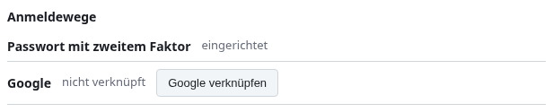

**Einen Anmeldeweg verknüpfen.** Klicke bei dem Anbieter auf **Verknüpfen**. Du wirst zum Anbieter weitergeleitet und wählst dort das Konto aus. Danach landest du wieder in aBoard, und der Dialog sagt dir, ob es geklappt hat. Ohne Passwort meldest du dich vorher einmal neu an (siehe oben). Ein Anbieter-Konto kann zu **einer** Person gehören; gehört es schon jemand anderem, wird nichts verknüpft. Hast du bei diesem Anbieter schon ein Konto verknüpft, **ersetzt** das neue das bisherige (so wechselst du dein Google-Konto). Danach endet die Anmeldung auf allen anderen Geräten; du bleibst hier angemeldet. Das ist die Antwort auf „Ich habe ein neues Google-Konto“: neues Konto verknüpfen, fertig.

**Einen Anmeldeweg lösen.** Klicke auf **Lösen**. Dein **letzter** Anmeldeweg lässt sich nie lösen, sonst kämst du nicht mehr herein. Auch das Lösen beendet alle anderen Sitzungen; du bleibst angemeldet. Hast du den Zugang zu deinem alten Anbieter-Konto schon verloren und kommst deshalb nicht in die Konto-Einstellungen, hilft der Betreiber (er kann die Bindung lösen, deine Boards und Rechte bleiben).

**Eigenes Passwort anlegen.** Meldest du dich bisher nur über einen Anbieter an und hat der Betreiber es eingeschaltet, steht im Dialog der Abschnitt **Passwort anlegen**. Klicke auf **Passwort mit zweitem Faktor anlegen** und melde dich, wie oben beschrieben, beim Anbieter neu an. Danach richtest du die Authenticator-App ein (QR-Code scannen oder Schlüssel eintippen), wählst dein Passwort (mindestens 12 Zeichen, zweimal) und gibst den ersten Code aus der App ein. Du bekommst **Wiederherstellungscodes**, die nur jetzt erscheinen: aufschreiben oder sicher ablegen. (Sagt der Dialog dabei „bitte neu anmelden“, gilt das Passwort trotzdem; schreibe die Codes auf und melde dich neu an.) Ab dann meldest du dich wahlweise mit E-Mail-Adresse, Passwort und Code an oder wie bisher beim Anbieter. Alle anderen Sitzungen enden; du bleibst angemeldet. Fehlt der Abschnitt, ist die Funktion auf deinem Server aus.

**Passwort ändern.** Neues Passwort zweimal eingeben (mindestens 12 Zeichen) und **Passwort ändern**. Alle **anderen** Sitzungen enden; du selbst bleibst angemeldet.

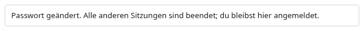

**Authenticator-App neu einrichten.** Auf **2FA neu einrichten** klicken: Du siehst einen neuen QR-Code und den Schlüssel zum Eintippen. Richte die neue App ein und gib den ersten Code daraus ein. **Erst dann** gilt die neue App; bis dahin funktioniert die bisherige weiter. Du bekommst **neue Wiederherstellungscodes**, die alten sind danach ungültig. Die Codes erscheinen **nur jetzt**: aufschreiben oder sicher ablegen. Auch hier enden alle anderen Sitzungen.

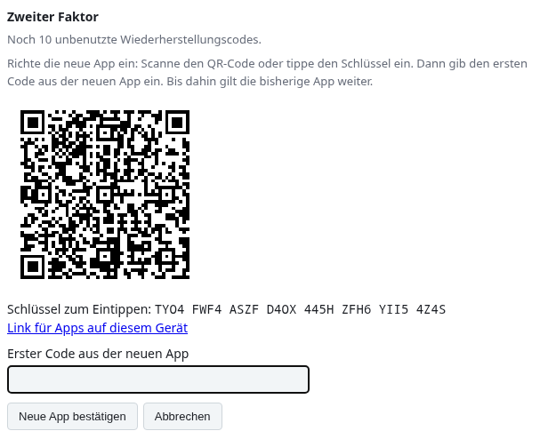

**Neue Wiederherstellungscodes.** Brauchst du nur neue Codes (die alten sind aufgebraucht oder verloren), erzeugst du sie mit **Neue Wiederherstellungscodes erzeugen**. Die bisherigen verfallen.

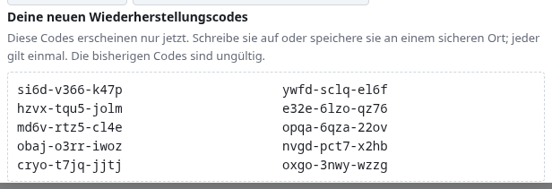

**Wer kein eigenes Passwort hat** (Zugang nur über einen Anbieter, oder vom Betreiber vorab freigegeben), sieht die Anmeldewege nur und kann sie hier nicht ändern; Passwort und zweiten Faktor gibt es für diesen Zugang nicht. Beenden kannst du auch dann die anderen Sitzungen.

### Abmelden, besonders auf fremden Rechnern

Auf deinem eigenen Rechner musst du dich nicht abmelden. Auf einem **fremden oder geteilten Rechner** meldest du dich immer ab, wenn du fertig bist:

1. Klicke oben links auf das **Logo**. Das Menü geht auf.
2. Klicke auf **Abmelden**.

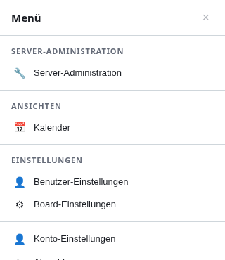

Du siehst die Seite „Abgemeldet“:

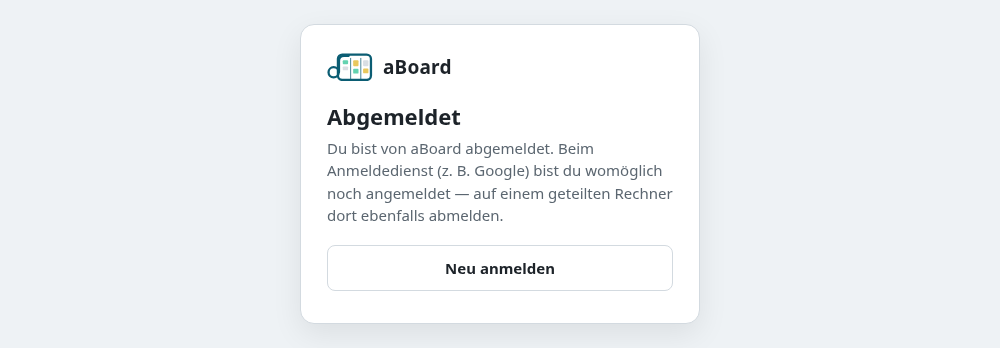

Hast du dich über Google oder einen anderen Anbieter angemeldet, bist du dort **womöglich noch angemeldet**. Melde dich dort auch ab. Sonst kann die nächste Person am selben Rechner in deinem Namen weiterarbeiten.

Auf fremden Rechnern außerdem:

- Lass den Browser dein Passwort **nicht speichern**, wenn er fragt.
- Schließe nach dem Abmelden das Browserfenster.
- Schreib niemals Passwort oder Wiederherstellungscodes in eine Datei auf diesem Rechner.

### Für Admins: ein Blick auf die Gegenseite

Wer die Konten verwaltet, findet alles im Reiter „User-Verwaltung“ der Server-Administration (Menü, Eintrag „Server-Administration“). Einladen, Bestätigen, Sperren und Zurücksetzen erklärt [Server verwalten](server/administration.md#konten-und-einladungen-eingebaute-anmeldung). Zur Orientierung die Bilder, so wie die eingeladenen Personen sie im Abschnitt oben erleben:

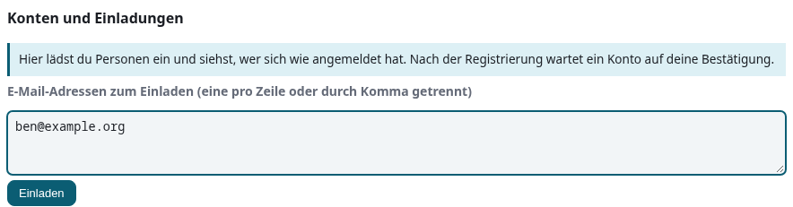

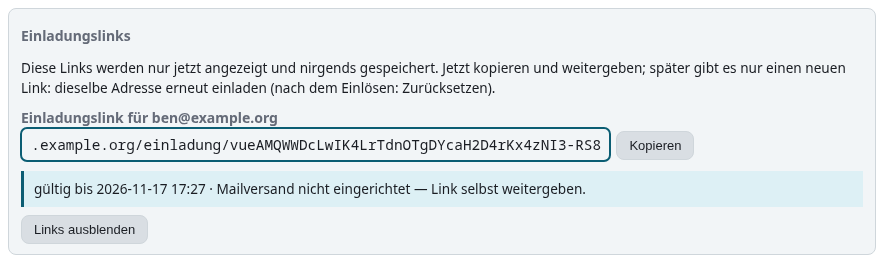

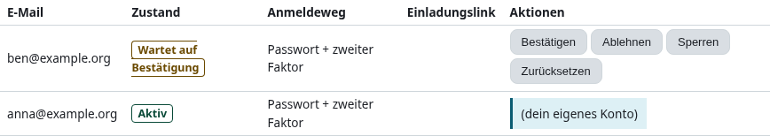

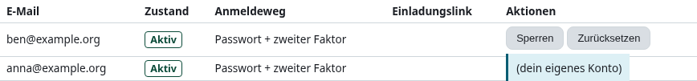

## Board in einem Ordner (Projekt-Modus)

Mit **Logo → Board-Einstellungen → „Ordner wählen…“** legt aBoard das Board als `aboard-sync.json` in einen Ordner und prüft regelmäßig, ob sich dort etwas geändert hat. Das braucht die **File System Access API** (Chrome, Edge und andere Chromium-Browser); nach einem Browser-Neustart fragt der Browser einmal nach der Erlaubnis. Bearbeite `aboard-sync.json` nie von Hand, sondern immer über die Board-Oberfläche.

### Der Ein-Tab-Grundsatz

**Halte immer nur einen Browser-Tab mit dem Board gleichzeitig offen.**

Solange ein Tab offen ist, hält der Browser einen eigenen Zwischenspeicher (`localStorage`) mit deinem letzten Bearbeitungsstand. Öffnest du einen zweiten Tab, etwa weil der erste eingefroren wirkt, bringt der einen **eigenen, möglicherweise veralteten** Zwischenspeicher mit. Wird daraus ein Stand wiederhergestellt oder verglichen, kann das aussehen wie eine riesige Menge gelöschter Karten, obwohl nichts davon beabsichtigt war.

`aboard.html` hat dagegen eine eingebaute Bremse (die Einzeldatei nicht): Ein Löschvorgang, der ungewöhnlich viele Karten (mehr als 20) oder Swimlanes (mehr als 2) auf einmal betrifft, löst eine Sicherheitsabfrage mit der genauen Anzahl aus, bevor etwas geschrieben wird. Die Voreinstellung dieser Abfrage ist „Abbrechen“. Die Bremse ist ein zusätzliches Netz, aber kein Ersatz für die Regel: **ein Tab, ein aktueller Stand.**

Praktisch heißt das: Vor dem Öffnen eines neuen Tabs den alten wirklich schließen, nicht nur ein neues Fenster daneben aufmachen.

## Weiterlesen

- [Varianten](varianten.md) — welche Betriebsart was kann
- [Server verwalten](server/administration.md#konten-und-einladungen-eingebaute-anmeldung) — für Admins: Einladungen, Bestätigen, Zurücksetzen
- [Installation](installation.md) — einrichten und aktualisieren
